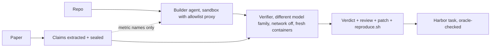

# PaperCI

**CI for research papers. It reruns the code and checks the numbers.**

_Built for neatHack 2026. Independent project; not affiliated with Hugging Face, arXiv or any paper's authors._

**It's running right now.** [Live board](https://paperci.vercel.app/board) ·
[ICML 2026 results, by paper](https://paperci.vercel.app/icml) · [Technical write-up](TECHNICAL_WRITEUP.md)


Every pull request gets a bot that runs the tests. Papers get nothing. "Code available" usually means "a repo
exists"; whether it runs, and whether it prints the numbers in the paper, nobody checks.

PaperCI checks. It reads the paper, writes down the headline numbers and seals them, builds the repo from
scratch in a locked sandbox, reruns it with the network off, and compares what the code prints with what the
paper claims. The output reads like a code review: a claims-vs-measured table, the patch it needed, and a
`reproduce.sh` that works.

### Latest changes

**2026-10-12**

- **External check against the community.** 116 ICML 2026 papers where independent teams in Hugging Face's
  [Open Reproductions](https://huggingface.co/datasets/ICML-2026-agent-repro/verdicts) agreed on the outcome are
  rerun blind. The community verdict is the answer key; no agent ever sees it. Results are public by paper name
  at [/icml](https://paperci.vercel.app/icml).
- **Learning from other people's logbooks.** The nightly improver now reads methods notes from community
  logbooks of *other* papers and turns them into recovery rules for its own failures. They are tested like
  any other change before they are adopted. [How](TECHNICAL_WRITEUP.md#learning-from-community-logbooks).
- **New models.** Builder: DeepSeek V4.1 Flash. Verifier and everything always-on: GLM-5.3-Flash. Still two
  different model families.
- Fixed: GitHub rate limits were being recorded as "repo unavailable", which rejected 24 good papers.

**2026-10-11**

- Evolution rounds: the agent proposes changes to its own playbook and control policy, runs them on a fixed
  benchmark against the current version, and keeps a change only if it scores higher.
- Web app with a concierge agent for authors; self-healing layers on the server, drilled nightly.

## Quick start

Python 3.12, Docker running.

```
uv venv .venv
uv pip install --python .venv/bin/python "neatlogs[openai]" openai pydantic requests python-dotenv fastapi uvicorn python-multipart
cp .env.example .env        # NEATLOGS_API_KEY, plus LITELLM_API_KEY or FACTORY_API_KEY
docker build -t paperci/proxy:latest sandbox/proxy
docker build -t paperci/sandbox:base sandbox/runner   # Windows: powershell -File scripts\build_images.ps1
python scripts/test_sandbox.py         # checks: non-root, allowlist, offline mode, no secrets
python tests/test_offline.py           # 15 offline checks, no API keys needed
```

Review one paper:

```
python -m paperci review 2503.01072                 # arXiv id or URL, live progress, ends in a review page
python -m paperci review --file paper.pdf --repo https://github.com/you/code
```

Or the web app, where an agent talks to you while it works (`python -m paperci.web`, then
http://127.0.0.1:8000). The hosted one at [paperci.vercel.app](https://paperci.vercel.app) needs an invite code
for now, because every run costs real compute.

## How it works



- **The builder never sees the numbers.** Claims are pulled from the paper with verbatim quotes and sealed
  (sha256) before the build starts. The builder gets metric names only; matching numbers in the README are
  redacted.
- **Someone else grades it.** A verifier from a different model family reruns the script in fresh containers
  with `--network none` and reads only the output files.
- **It catches shortcuts, including its own.** Hardcoded values, copied result files, replayed stored results
  and scripts that never call the repo's code all fail the review.
- **Every reproduction becomes a task.** A passing run is packaged as a Harbor task and only kept if its own
  oracle replays to reward 1.


That one is real: on our held-out set the run script loaded stored results and finished in seconds. The
`precomputed_results_replay` check exists because of it ([screenshot](docs/img/review-caught.png)).

## Results

### Held-out papers (before vs after self-improvement)

10 fresh arXiv papers taken in queue order, never used for tuning. Same papers, same sealed claims. These runs
used the earlier models (Claude Sonnet 4.6 builder, Amazon Nova Pro verifier).

| Metric | Before | After |
| --- | --: | --: |
| Built and ran offline | 3/10 | **5/10** |
| Faithful reproductions | 1 | **2** |
| Claims within tolerance (n ≥ 2 reruns) | 0 | **2** |
| Oracle-validated tasks | 0 | **2** |
| Builder turns per paper | 16.5 | **11.8** |
| LLM cost per paper | $0.24 | **$0.18** |
| Runs thrown out by integrity checks | 3 | 3 |

Small sample, so read these as signals, not proof. Per-paper rows and trace ids are in
[docs/evidence.md](docs/evidence.md).

### ICML 2026, against the Hugging Face community

The answer key is papers where at least two independent medium/high-quality logbooks agreed (75% or more)
that the paper was verified or falsified: 116 papers (47 verified, 69 falsified). PaperCI runs them blind on a
CPU, and the results come in as runs finish. Live numbers and every paper by name:
**[paperci.vercel.app/icml](https://paperci.vercel.app/icml)**.

Two caveats up front. The community had GPUs and PaperCI does not, so it will often say "no decision". And the
community labels were graded by GLM-5.2, the same model family as our verifier, so agreement may be inflated.

### What it costs

About $0.04 to $0.20 of LLM per paper, depending on the model. The front half (finding the code, triage,
sealing claims) is about $0.01. See [docs/unit-economics.md](docs/unit-economics.md).

## It improves itself (carefully)

Every night it reads its own failures from the neatlogs traces, proposes new recovery rules, a rewritten
control policy, and rules learned from community logbooks. Each candidate is run for real on a fixed benchmark
against the current version.

- Adopted only if it scores higher, with no regression and no integrity flag.
- Code changes (the control policy) also wait for a human `approve`.
- Every adopted change is re-checked on live papers and rolled back automatically if they get worse.
- The verifier, sealed claims, tolerances, cost ledger and held-out split are fingerprinted. If anything
  touches them, the round is void.

Details: [docs/evolution.md](docs/evolution.md).

## It heals itself

On the server, a watchdog repairs Docker, the egress proxy, orphaned sandboxes, disk pressure and the web app,
and logs each repair as an incident on the board. Something also watches the watchdog. Bad deploys roll back on
their own, and it breaks itself on purpose every night (chaos drills) to check that all of this still works.
Details: [docs/cloud.md](docs/cloud.md).

## Safety

- Third-party code only runs in Docker: uid 1000, `--cap-drop ALL`, `no-new-privileges`, CPU/memory/pid limits,
  no host mounts, no credentials. Setup network goes through an allowlist proxy (PyPI, PyTorch wheels, GitHub,
  Hugging Face, Zenodo, UCI, OpenML); the scored run has no network.
- Repo text is untrusted: every system prompt carries a prompt-injection warning.
- Live arXiv papers and author submissions are anonymized on the public board. ICML 2026 papers are named,
  because they and their community verdicts are already public.
- Secrets live in `.env` (git-ignored), are scanned for before every push, and are redacted from Entire
  checkpoints.

## Limits

- CPU only, minutes-scale. Most fresh ML papers need GPUs, hosted LLM APIs, gated data or large weights; they
  are rejected at triage or end as `blocked-infra`. This is the biggest limitation.
- Claims come from paper text. Numbers that only live in figures are missed.
- A reduced-scale run is reported as `toy-scale` and never counts as verified.
- The trainability check uses 2 cheap-solver attempts, so it is coarse.

## Docs

- [Technical write-up](TECHNICAL_WRITEUP.md): how it was built, what broke, trade-offs
- [ICML eval](docs/icml-eval.md): reference labels, protocol, biases
- [Evolution](docs/evolution.md): rounds, gates, canary, approvals
- [Cloud and self-healing](docs/cloud.md)
- [Evidence](docs/evidence.md): held-out numbers with trace ids
- [Unit economics](docs/unit-economics.md) · [Landscape](docs/landscape.md) · [neatlogs feedback](docs/neatlogs-feedback.md)
- [Earlier example reviews](docs/reviews/index.html) (anonymized)

## Built with

**neatlogs** traces every LLM call and stage, and the improver learns from those traces. **Entire** captures
the build sessions as checkpoints on commits. **cfo.ai** was used for the business plan
([unit economics](docs/unit-economics.md)). LLMs: DeepSeek V4.1 Flash and GLM-5.3-Flash through the Factory API;
earlier runs used Claude and Amazon Nova through LiteLLM.
