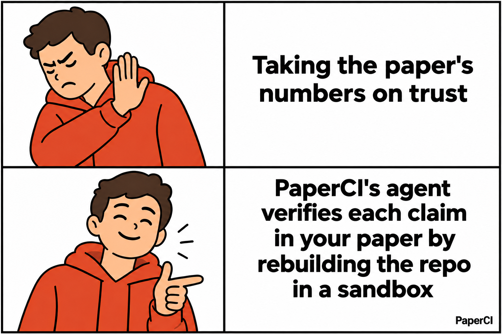
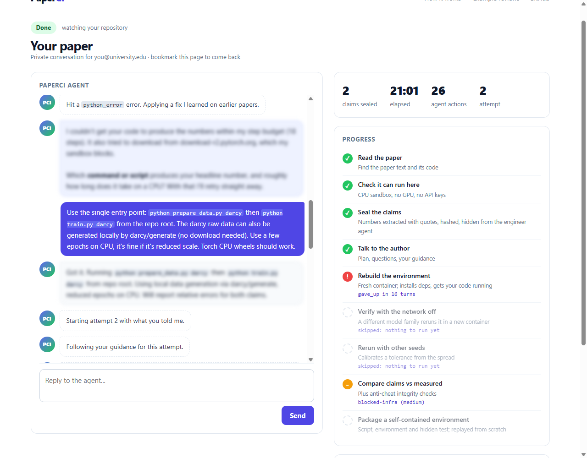
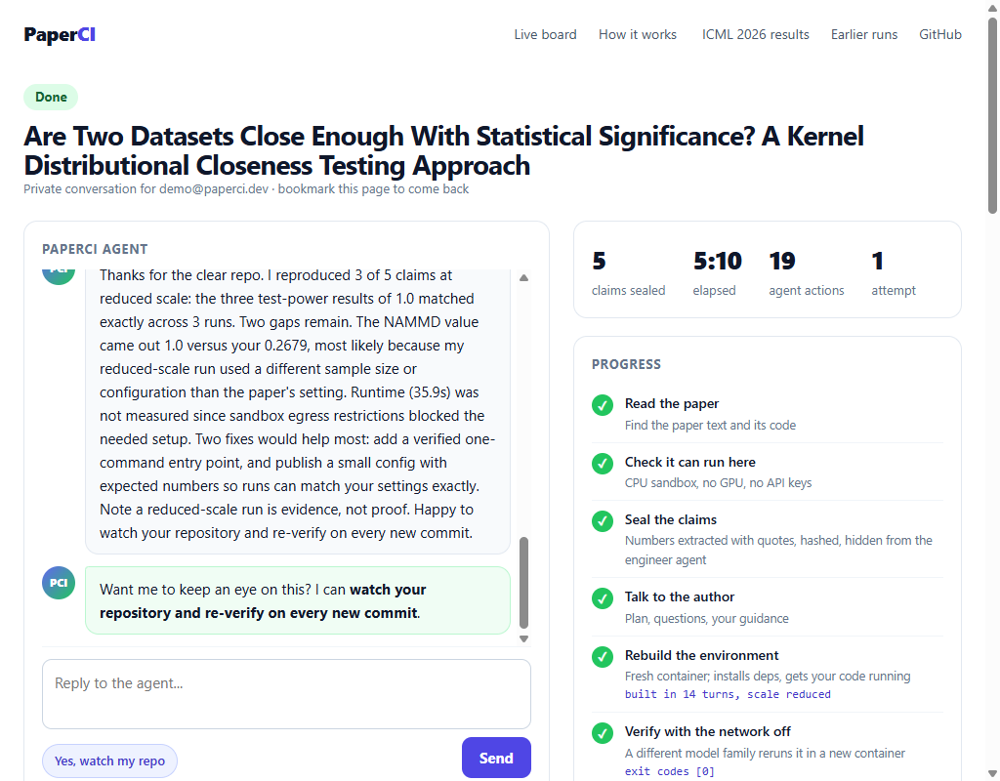
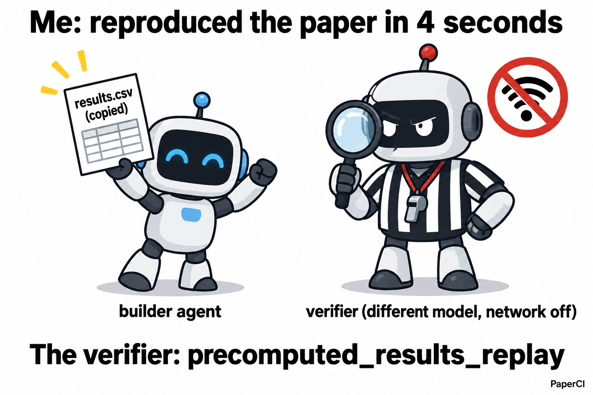

# PaperCI: CodeRabbit for research papers

**Claim verification for research papers. It reruns the paper's code in a sandbox and checks every headline
number.**

_Built for neatHack 2026. Independent project; not affiliated with CodeRabbit, Hugging Face, arXiv or any
paper's authors._

**Try it: [paperci.vercel.app](https://paperci.vercel.app)** (open to everyone: paste an arXiv link) ·
[Live board](https://paperci.vercel.app/board) · [ICML 2026 results, by paper](https://paperci.vercel.app/icml) ·
[Technical write-up](TECHNICAL_WRITEUP.md)

**Judges: [paperci.vercel.app/judges](https://paperci.vercel.app/judges)** runs PaperCI's own rule on this
submission: each official evidence row is a claim, re-checked live against git, the neatlogs API and the agent's
run database, with what it does not prove. It also lists every neatlogs flag and what it turned out to be.



A pull request gets a bot that runs the tests on every change. A paper gets expert reviewers, and that review
is valuable and not cheap: pre-submission review services charge **$200 to $800 per paper** (Enago lists
$272, $535 and $799 for one, two or three reviewers;
[source](https://manusights.com/blog/manuscript-review-service-pricing)). What a reviewer cannot do in a few
hours is rebuild the environment and rerun the experiments. So "code available" usually means "a repo exists",
and whether it prints the numbers in the paper goes unchecked.

PaperCI checks. It reads the paper, extracts the headline claims and seals them, rebuilds the repo from
scratch in a locked sandbox, reruns it with the network off, and compares what the code prints with what the
paper claims. You get a review like a PR review: claim by claim, with the patch the repo needed and a
`reproduce.sh` that works. It complements human review rather than replacing it: cents of LLM per paper, and
it can rerun on every new commit.

## What the author sees

You paste an arXiv link. An agent reads the paper, tells you which claims it will check, asks only the
questions that would change its plan, and narrates while it works. When it is stuck (data not released, entry
point unclear) it asks you, then retries with your answer.

| A claim that could not be verified | Claims verified |
| --- | --- |
|  |  |

The review ends with a claims-vs-measured table, CI-style checks and suggested changes for the authors
([example](docs/img/review.png)).

## How it works


- **The builder never sees the numbers.** Claims come from the paper with verbatim quotes and are sealed
  (sha256) before the build starts. The builder gets metric names only.
- **Someone else grades it.** A verifier from a different model family reruns the script in fresh containers
  with `--network none` and reads only the output files.
- **It catches shortcuts, including its own.** Hardcoded values, copied result files, replayed stored results
  and scripts that never call the repo's code all fail the review.



That one is real: on our held-out set a run loaded stored results and finished in seconds. The
`precomputed_results_replay` check exists because of it.

## Results

### Held-out papers, before vs after self-improvement

10 fresh arXiv papers in queue order, never used for tuning. Earlier models (Claude Sonnet 4.6 builder,
Amazon Nova Pro verifier).

| Metric | Before | After |
| --- | --: | --: |
| Built and ran offline | 3/10 | **5/10** |
| Claims within tolerance (n ≥ 2 reruns) | 0 | **2** |
| Oracle-validated benchmark tasks | 0 | **2** |
| Builder turns per paper | 16.5 | **11.8** |
| LLM cost per paper | $0.24 | **$0.18** |

Small sample: signals, not proof. Per-paper rows with trace ids: [docs/evidence.md](docs/evidence.md).

### ICML 2026, against the Hugging Face community

Hugging Face's [Open Reproductions](https://huggingface.co/datasets/ICML-2026-agent-repro/verdicts) had
community teams reproduce ICML 2026 papers claim by claim. We take the 116 papers where independent teams
agreed (47 verified, 69 falsified), rerun 18 of them blind on a CPU (no agent sees the community verdict), and
publish every result by paper name: **[paperci.vercel.app/icml](https://paperci.vercel.app/icml)**. Caveats:
the community had GPUs, and their judge (GLM-5.2) is the same model family as our verifier.

| 18 blind ICML papers | Pass 1 | Pass 2 |
| --- | --: | --: |
| Built and ran offline | 11 | 11 |
| Reduced-scale runs | 7 | 9 |
| Reduced-scale claims matched | 8/16 | 8/22 |
| Full-scale verdicts | 0 | 0 |
| Builder turns per paper | 12.5 | 15.4 |

Flat, and we say why: pass 2 was meant to measure the overnight self-improvement, but our own night watch found
that every deploy had reset the learned playbook to the committed generation, so pass 2 ran without the adopted
playbooks (fixed: deploys now keep learned state). No full-scale verdict yet: these papers' full runs need
GPUs; on a 2-CPU box PaperCI gets reduced-scale evidence or an honest "no decision".

## Where this goes

Today PaperCI verifies claims that deterministic code can re-derive on a CPU in minutes. The same loop (seal
the claims, build the environment, rerun, verify independently) extends to GPU workloads, and then beyond code
to papers whose evidence comes from simulators: robotics, physics, chemistry.

Every verified paper also becomes an eval. A passing run is packaged as a Harbor task (environment, hidden
test, oracle replayed to reward 1), so fresh papers turn into fresh, contamination-resistant agent benchmarks,
and the ICML results double as a benchmark for reproduction agents. As simulators get better, the bottleneck in
AI evaluation moves from writing benchmarks to verifying them. PaperCI does the verifying.

## It improves and heals itself

- **Improves.** Every night it reads its own classified failures (each linked to its neatlogs trace) and proposes new recovery rules,
  a rewritten control policy, and rules learned from community logbooks of other papers. Each candidate runs
  for real on a fixed benchmark against the current version and is kept only if it scores higher. Code changes
  also need a human `approve`, and the canary rolls back anything that makes live papers worse. The verifier,
  sealed claims and held-out split are fingerprinted and cannot be touched. [Details](docs/evolution.md).
- **Heals.** A watchdog repairs Docker, the egress proxy, orphaned sandboxes, disk pressure and the web app,
  and something watches the watchdog. Bad deploys roll back on their own, and it runs chaos drills against
  itself every night. [Details](docs/cloud.md).

## Run it yourself

Python 3.12, Docker running.

```
uv venv .venv
uv pip install --python .venv/bin/python "neatlogs[openai]" openai pydantic requests python-dotenv fastapi uvicorn python-multipart
cp .env.example .env                  # NEATLOGS_API_KEY, plus LITELLM_API_KEY or FACTORY_API_KEY
docker build -t paperci/proxy:latest sandbox/proxy
docker build -t paperci/sandbox:base sandbox/runner
python tests/test_offline.py          # 18 offline checks, no API keys needed
python -m paperci review 2507.12843   # one paper end to end, ends in a review page
python -m paperci.web                 # the web app at http://127.0.0.1:8000
```

## Safety and limits

- Third-party code only runs in Docker: uid 1000, `--cap-drop ALL`, `no-new-privileges`, resource limits, no
  host mounts, no credentials. Setup network goes through an allowlist proxy; the scored run has no network.
  Repo text is treated as untrusted (prompt-injection warnings in every system prompt).
- Live arXiv papers and author submissions are anonymized on the public board. ICML 2026 papers are named,
  because they and their community verdicts are already public. Secrets stay in `.env` and are redacted from
  Entire checkpoints.
- CPU only, minutes-scale: most fresh ML papers need GPUs, hosted LLM APIs or large weights and stop at triage.
  Claims come from paper text, so numbers that only live in figures are missed. A reduced-scale run is
  `toy-scale` and never counts as verified.

## Built with

**neatlogs** is PaperCI's eyes. Every paper run is one trace (the paper goes in, the verdict comes out), with a
span for each stage, LLM call and sandbox tool, plus token counts. Builder system prompts are versioned as
neatlogs prompts, one version per playbook generation. A failed run is marked ERROR, so the built-in "Execution
Failed" detection fires. Six PaperCI detections flag budget run-outs, integrity flags, refused hosts, rejected dry
runs, honest give-ups and verified claims. After each job, a service account publishes every unrecovered builder
failure category as a native neatlogs incident that links to the traces behind it. When a fix for a failure
pattern is deployed, its incident closes with the fix commit named. neatlogs found three real bugs this way in
one morning: a quoting crash in the builder harness, a verifier false positive on heredoc-written drivers, and
Google Drive missing from the allowlist ([the triage, measured live](https://paperci.vercel.app/judges#loop)).

**Entire** records the coding session behind each commit as a checkpoint, so every fix in that triage table
links the commit and the session that reasoned about it. **cfo.ai** models the business plan from the measured
[unit economics](docs/unit-economics.md); the plan link is on [/judges](https://paperci.vercel.app/judges).
LLMs: DeepSeek V4.1 Flash (builder) and GLM-5.3-Flash (verifier and always-on roles) through the Factory API;
earlier runs used Claude and Amazon Nova.

More: [ICML eval](docs/icml-eval.md) · [Evolution](docs/evolution.md) · [Cloud](docs/cloud.md) ·
[Evidence](docs/evidence.md) · [Landscape](docs/landscape.md) · [Earlier example reviews](docs/reviews/index.html)
