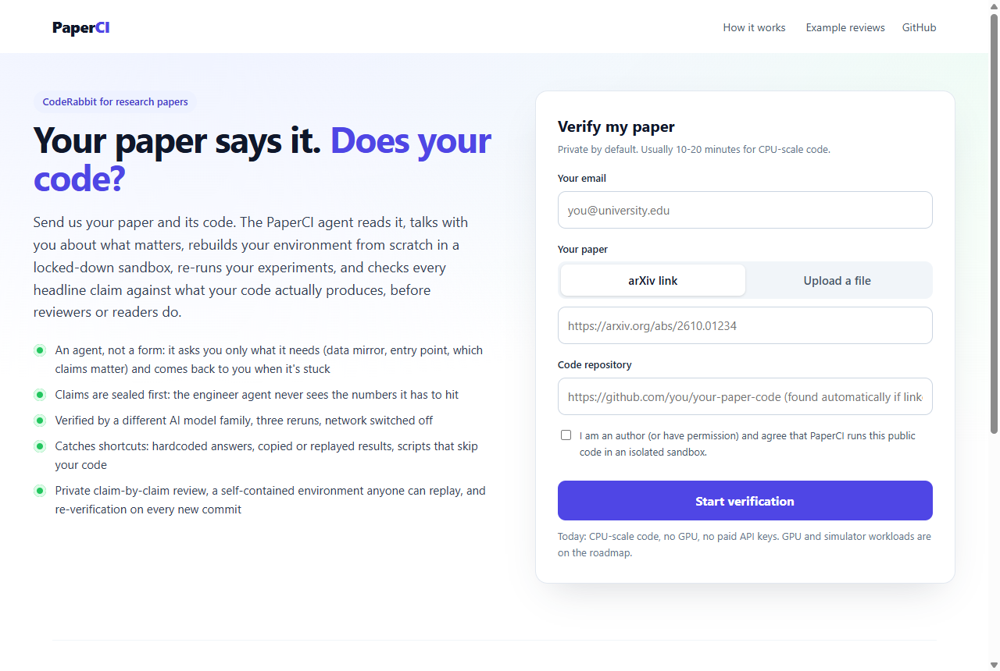
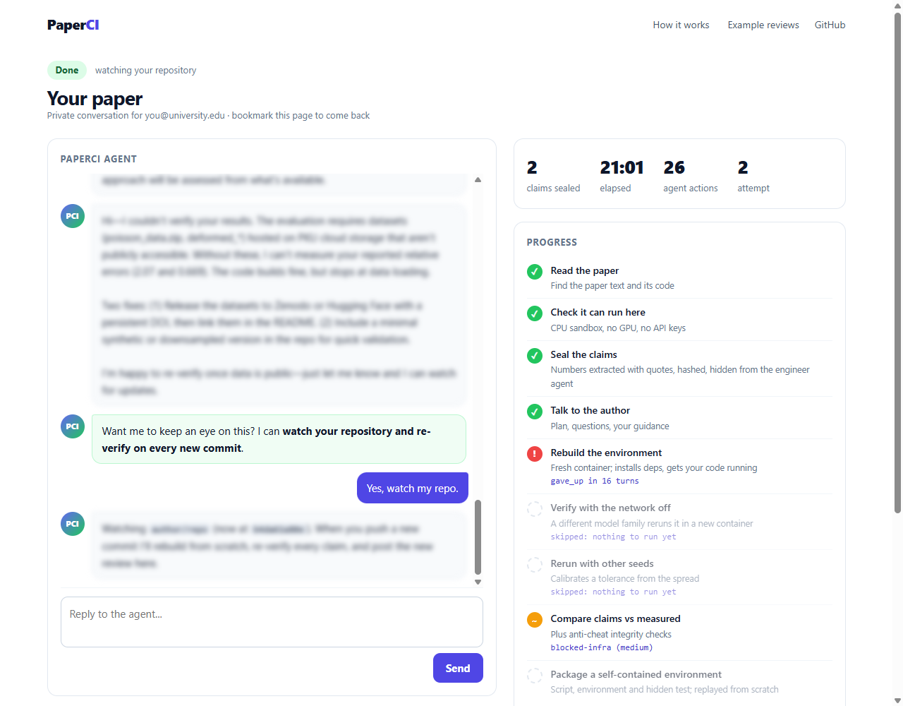
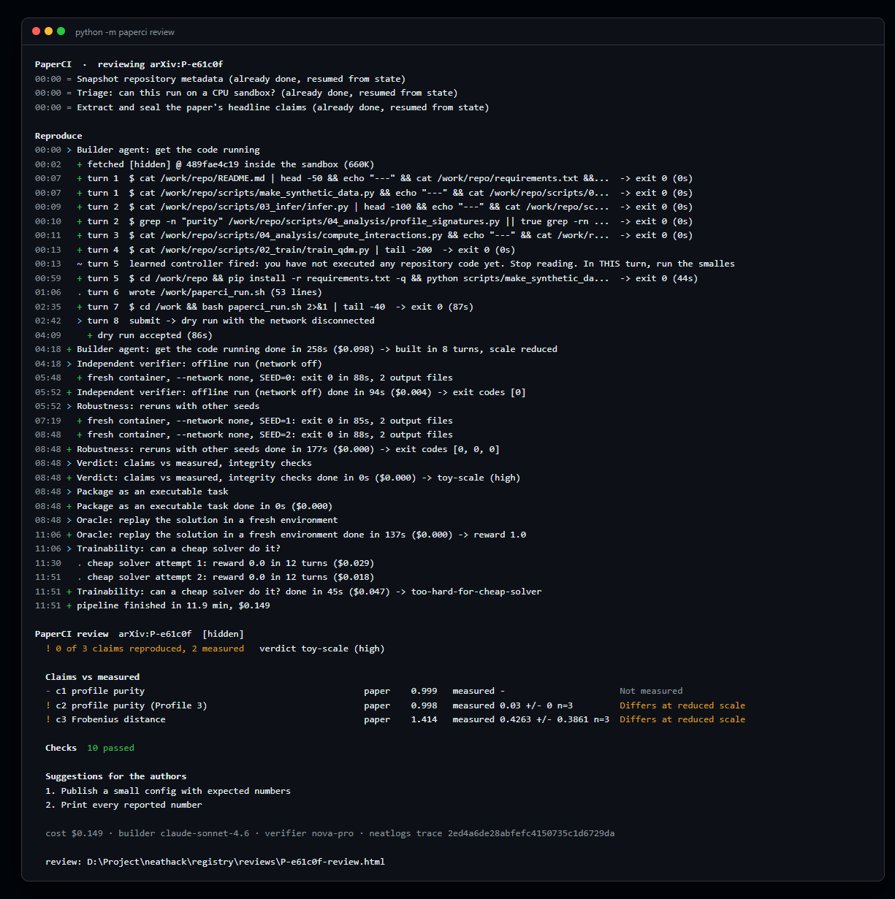
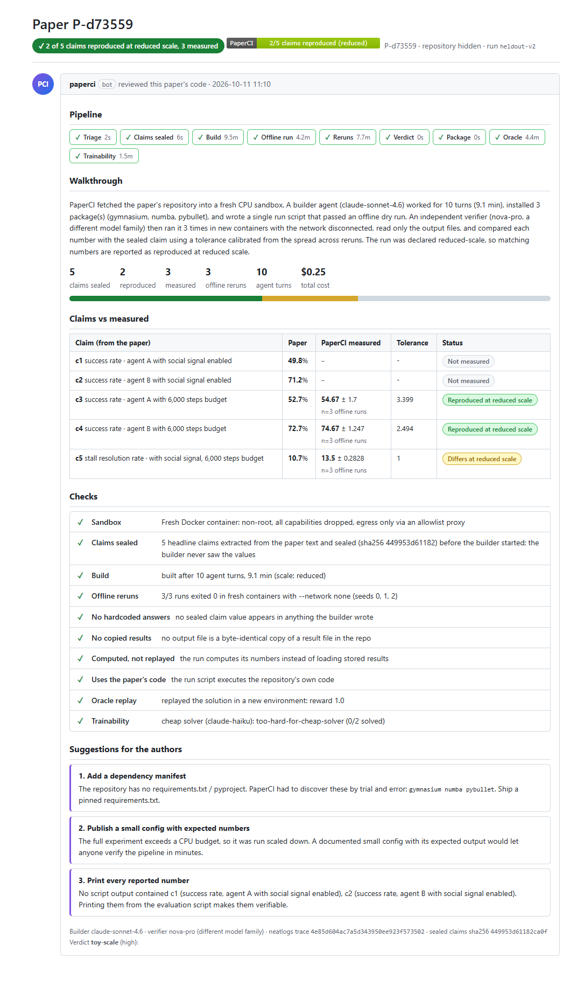

# PaperCI: CodeRabbit for research papers

Every pull request gets a bot that runs the tests and reviews the change. Research papers get nothing: most
papers' code is never re-run by anyone. **PaperCI reviews a paper the way CI reviews a PR.** It doesn't lint the
code. It rebuilds the paper's environment from scratch in a fresh sandbox, re-runs the code, and checks
**every headline claim in the paper against what the code actually produces.**

### It is running right now

Until 2026-10-16 23:59 IST, PaperCI runs by itself on AWS. **Live board: https://paperci.vercel.app/board**
(anonymized). Every 90 minutes it pulls new arXiv papers with code, triages them, seals their claims and
reproduces the freshest one. Every night it learns new recovery rules from the day's failures (gated; held-out
papers never feed it), runs a chaos drill against itself, and writes a digest. A watchdog repairs Docker, the
egress proxy, orphaned sandboxes, disk pressure and the web app on its own, and logs each repair as an
incident. Details: [docs/cloud.md](docs/cloud.md).

Reviews now end like a CodeRabbit PR review, with **verified suggested changes**. These are the exact repo patch
the agent needed, a `reproduce.sh` entry point and a pinned `requirements.lock.txt` of the environment that
worked. They are verified because PaperCI applied them and re-ran the paper's code offline in fresh
containers. Each comes as a downloadable `paperci.patch` (`git apply paperci.patch`).

### For authors: the web app (an agent you talk to, not a form)

```
python -m paperci.web        # http://127.0.0.1:8000
```

1. **Submit**: your email, then an arXiv link or your paper file (PDF, LaTeX `.tex` or source `.zip`/`.tar.gz`,
   Word `.docx`, HTML, Markdown, text) and the GitHub repo (found automatically if the paper links it).
2. **The agent reads and talks to you.** It seals your headline claims, inspects the repo, and opens a chat:
   what it found, its plan, and only the questions that would change the plan (which claim matters most, the
   command that produces a number, a reachable mirror for data hosted on Drive/Dropbox/a university server).
   If you don't answer, it starts with its own plan.
3. **It works and narrates.** Progress, the hosts it connected to (GitHub, PyPI, Hugging Face, ...; blocked ones
   in red), and plain-language updates ("Cloned your repo...", "I've read enough; switching to running it",
   "Your code ran end to end with the network off"). Your guidance goes to the engineer agent with any sealed
   numbers redacted.
4. **It comes back when it's stuck.** If data isn't released, a credential is needed, or it can't find the
   entry point, it asks you exactly that (chat + email), then retries with your answer (up to 3 attempts).
5. **Review + follow-up.** A claim-by-claim review in the page, a badge, a self-contained environment, and
   an offer to watch your repo and re-verify on every new commit.





(Screenshots use the page's `?redact=1` mode, which hides the paper's identity; the real page is private to the author.)

### From the terminal

```
python -m paperci review <arxiv-id-or-url>        # whole pipeline, live, ends in a review
python -m paperci review --file paper.pdf --repo https://github.com/you/code   # any academic file format
python -m paperci review <arxiv-id> --from-run L  # re-render the review of an earlier run (no spend)
python -m paperci reviews                         # PR-list style index of every review
```

A real run (12 minutes, $0.15, paper identity hidden). Note turn 5: the learned controller forces the agent
to stop reading and run code; the review at the end is honest that the numbers differ at reduced scale.



The output is a review page like a CodeRabbit PR comment (`registry/reviews/<paper>.html` + `.md` + a README
badge `.svg`): a pipeline strip, a walkthrough of how the environment was built, a **claims-vs-measured table**
(paper value, measured mean ± sd over offline reruns, calibrated tolerance, status), CI-style checks
(sandbox, sealing, offline reruns, anti-cheat, oracle), **actionable suggestions for the authors**, and a
"reproduce it yourself" section with the exact script and every command the agent ran.



Browse every review PaperCI has produced (anonymized, open the HTML locally or via GitHub Pages):
[`docs/reviews/index.html`](docs/reviews/index.html).

Why you can trust a PaperCI review:
- **The agent that builds never sees the numbers it has to hit.** Claims are extracted from the paper text with
  verbatim quotes and sealed (sha256) before the build starts.
- **A different model family judges.** The builder is Claude; the verifier is Amazon Nova, which reruns the
  script in fresh containers with the network disconnected and reads only the output files.
- **It catches shortcuts, including its own agent's.** Hardcoded answers, copied result files, replayed
  precomputed results, and run scripts that never call the repo's code all fail the review
  ([a real case](docs/img/review-caught.png): the run replayed stored results, so no claim was trusted).
- **Every reproduction becomes a task.** A run that passes is packaged as a Harbor task whose oracle is
  validated by replay, so fresh papers become fresh, verifiable agent benchmarks.

It also **improves itself and heals itself**: failures in its own neatlogs traces become recovery rules, an
enforced control policy and a better sandbox image (gated, measured on held-out papers it never tuned on);
infrastructure faults (dead proxy, crashed containers) are repaired and retried automatically.

For authors: `integrations/github-action/paperci-review.yml` runs the same review on every release of the
paper's repo and posts it to the job summary with a badge (template; see the file header).

**Where this goes.** Today PaperCI handles papers whose claims can be re-derived by deterministic code on a
CPU in minutes. The same loop (seal the claims, build the environment, rerun, verify independently) extends
to GPU workloads and then to papers whose evidence comes from simulators: robotics, physics, chemistry. As
simulation environments get better, the bottleneck in AI evaluation shifts from writing benchmarks to
verifying them, and PaperCI turns each new paper into one.

Built for neatHack 2026 with **neatlogs** (every LLM call and stage traced), **Entire** (build sessions
captured as checkpoints on commits) and **cfo.ai** (business plan, see `docs/unit-economics.md`).

## What happens to one paper

```
watcher (arXiv API + HF Daily Papers) ─> triage gate (rules + nova-micro)
  ─> sealed claim extraction (nova-pro, grounded quotes, sha256-sealed)
  ─> builder agent (claude-sonnet-4.6, own tool loop, sandbox tools; never sees claim values)
       └─ offline dry run on submit (network disconnected)
  ─> independent verifier (fresh container, --network none, reads artifacts only;
       deterministic extraction first, nova-pro only for ambiguous logs, quote must exist)
  ─> robustness (re-runs with other seeds, tolerance calibration)
  ─> verdict: verified | falsified-candidate | toy-scale | inconclusive | blocked-infra
  ─> packager (Harbor task: instruction.md, task.toml, environment/Dockerfile, solution/, tests/)
  ─> oracle check (replay builder's steps in a fresh env, hidden test must give reward 1)
  ─> trainability filter (claude-haiku solver, k attempts; keep "solved sometimes")
  ─> registry + dashboard (funnel, cost per stage, cost per validated task)
```

Self-improvement loop (`python -m paperci improve`, `python -m paperci envlearn`):

```
neatlogs-traced runs ─> failure taxonomy rebuilt from raw sandbox logs
  ─> improver agent proposes playbook rules + controller knobs
  ─> deterministic gates (regex recall/precision on real failures, integrity ban-list,
     stale-knowledge check vs current allowlist, cost projection vs cap)
  ─> new playbook generation (data/playbook.json, history in data/playbook_history/)
  ─> envlearn: packages installed in >= 2 papers are promoted into the sandbox image (install-gated)
  ─> measured on the held-out split, which the improver never sees
```

Frozen by design (the improver cannot touch these): verifier, claim sealing, tolerances, held-out split.

## Safety and integrity
- Third-party code only runs in Docker: uid 1000, `--cap-drop ALL`, `no-new-privileges`, CPU/mem/pid limits,
  no host mounts, no credentials. Build phase: `--internal` network whose only exit is a tinyproxy
  allowlist (PyPI, PyTorch wheels, GitHub, Hugging Face, Zenodo, UCI, OpenML). Verification: `--network none`.
- Repos are fetched as tarballs inside the sandbox; artifacts come out as tar streams, extracted file by file
  with path checks.
- Claims are sealed (sha256) before any build; the builder sees metric names only, README numbers matching
  sealed values are redacted, unseal is permission-checked and logged.
- Anti-cheat: sealed values searched in everything the builder authored (script, writes, commands, repo diff);
  output files hashed against the pristine repo (copied results); proxy logs list refused hosts.
- Integrity checks added after auditing our own held-out results (each one caught a real case):
  `precomputed_results_replay` (the run script loads stored results / finishes in seconds while reading
  result-like artifacts), `no_repo_code_path` (the run script never touches a repo module, e.g. a formula the
  builder wrote itself), claim-id tagged evidence for claims sharing one metric name, header-aware extraction
  (numbers in a `--- c2: ... 6000 steps ---` header are settings, not results), and whitespace-tolerant
  extraction specs (multi-line evidence). Any integrity flag blocks packaging; `scripts/reverify.py` re-judges
  every stored run with the current rules.
- A packaged task whose own oracle does not earn reward 1 is moved to `registry/rejected/`. Container deaths
  (daemon crash, exit 135/255) are retried as infra failures, never counted as task failures.
- Repo text is treated as untrusted (prompt-injection warnings in every system prompt).
- Verdicts about named papers are not published. `runs/`, `registry/` and reports are git-ignored; the public
  dashboard is anonymized.

## Setup (Windows, PowerShell; Linux/macOS analogous)
1. Python 3.12 venv: `uv venv .venv; uv pip install --python .venv\Scripts\python.exe "neatlogs[openai]" openai pydantic requests python-dotenv`
2. `.env` (git-ignored) with `NEATLOGS_API_KEY` (project key), `LITELLM_API_KEY`, `LITELLM_BASE_URL`, optional `CRUSTDATA_API_KEY`.
3. Docker Desktop running. Build images: `powershell -File scripts\build_images.ps1 -Tag base`
4. Self-test isolation: `python scripts\test_sandbox.py` (checks non-root, allowlist, offline mode, no secrets).
5. Offline unit checks: `python tests\test_offline.py`.

## Run
```
python -m paperci review <arxiv-id> [--anonymize] [--open] # one paper end to end -> review page
python -m paperci reviews                                 # re-render all reviews + index
python -m paperci watch                                   # fetch fresh code papers
python -m paperci prepare --limit 150                     # snapshot + triage + sealed claims
python scripts\show_queue.py heldout heldout-v1 5         # next papers in queue order
python -m paperci run --label heldout-v1 --variant v1 --ids <ids...>   # baseline builder
python -m paperci improve --labels dev-v1 --apply         # learn playbook generation N+1 from dev traces
python -m paperci envlearn --apply                        # promote recurring packages into the image
python -m paperci run --label heldout-v2 --variant v2 --ids <same ids>  # improved builder
python -m paperci stats | budget | dashboard [--public]
python scripts\nl_trace.py summary <trace-id>             # read the trace back from neatlogs (CLI)
```
Budgets (env-overridable, see `paperci/config.py`): $16 hard stop, $3 demo reserve, $0.60 per paper,
$0.45 builder, 18 turns default; every LLM call is pre-checked against the ledger and reconciled with the
proxy's `/key/info` spend.

## Results so far (measured, `docs/evidence.md`)
145 fresh code papers watched -> 55 pass the CPU gate -> 44 with grounded sealed claims. On the 10 held-out papers
(never used for tuning), the self-improved builder vs the baseline: built 3 -> 5, faithful reproductions 1 -> 2,
oracle-validated tasks 0 -> 2, agent turns 16.5 -> 11.8, LLM cost per paper $0.24 -> $0.18. Integrity checks
threw out 3 runs in each arm. Small sample; these are signals, not proof.

## Limits (honest)
- CPU-only, minutes-scale. Most fresh ML papers need GPUs, hosted LLM APIs, gated data, or large weights;
  they are rejected at triage or end as `blocked-infra`. The funnel shows this; it is the main limitation.
- Claims come from text (arXiv HTML / HF markdown). Strict grounding drops table numbers whose quotes do not
  survive HTML stripping.
- Reduced-scale runs are `toy-scale` and never count as verified; packaged tasks then reference our own
  offline measurement, not the paper's number.
- "Contamination-free" is partial: papers and READMEs are public. The hidden verifier uses our measurement.
- Trainability uses k=2 cheap-solver attempts: a coarse signal.
- Long traces (>10 min) were once observed to fail neatlogs finalization (DLQ); see docs/evidence.md.

## Repo map
`paperci/` pipeline (stages in `paperci/stages/`), `sandbox/` images, `scripts/` ops helpers, `tests/`,
`docs/` (landscape, unit economics, evidence, demo script, posts), `data/playbook.json` (learned policy).
